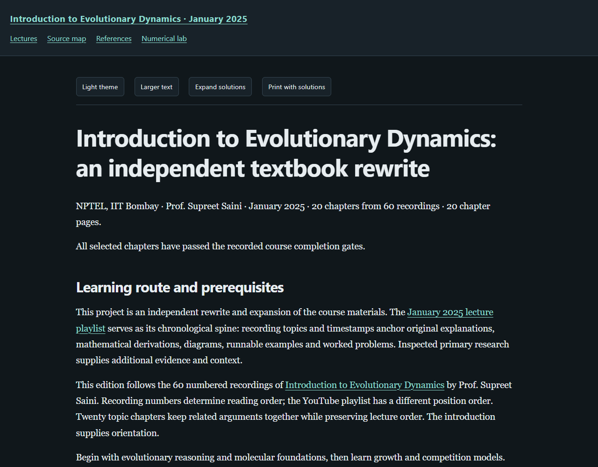

# Introduction to Evolutionary Dynamics — a textbook rewrite

**[Read the live textbook](https://az9713.github.io/nptel-introduction-to-evolutionary-dynamics-notes/)**

[](https://az9713.github.io/nptel-introduction-to-evolutionary-dynamics-notes/)

This project is an independent rewrite and expansion of the course materials
for Prof. Supreet Saini's NPTEL IIT Bombay
[Introduction to Evolutionary Dynamics](https://nptel.ac.in/courses/127101592).
The **[January 2025 YouTube playlist](https://www.youtube.com/playlist?list=PLOzRYVm0a65ckpdcVe8KLbhdWxzwT6x55)
serves as the spine**: it sets the topic sequence and provides timestamped
anchors for the exposition.

Around that spine, the project develops original explanations, definitions,
derivations, diagrams, runnable Python examples, and fully worked problems.
Inspected primary research extends and checks the lecture material. Source
maps distinguish lecture content, research evidence, and original teaching
constructions; empirical observations and synthetic examples carry separate
labels.

All **60 numbered lectures** are covered in **20 chronological topic chapters**,
with **120 worked chapter problems** and **six additional numerical-lab problems**.
The separate orientation video is included in the source index. Chapters follow
lecture numbers because the playlist's displayed order differs from the course
sequence. Every one of the **61 recordings** has a verified retained-media hash
and a complete preferred transcript: 26 retrieved uploader-provided English
tracks and 35 local machine transcriptions. The uploader's subtitle label does
not establish how the track was produced.

The reader includes searchable chapter navigation, local MathJax, light/dark
themes, adjustable text size, expandable solutions, printing with solutions,
and an interactive numerical laboratory. Rendering assets are bundled, so a
downloaded copy also works offline.

Explore the [source map](https://az9713.github.io/nptel-introduction-to-evolutionary-dynamics-notes/source-map.html),
[primary references](https://az9713.github.io/nptel-introduction-to-evolutionary-dynamics-notes/references.html),
and [numerical lab](https://az9713.github.io/nptel-introduction-to-evolutionary-dynamics-notes/numerical-lab.html).
The preview above opens the live GitHub Pages edition, served from `index.html`.

## Run locally

Open `index.html` after downloading the repository. To rebuild and check it:

```sh
python tools/build_book.py
python tools/validate_books.py --browser
python numerical_lab.py
python tools/audit_numerical_lab.py
```

The rebuild and worked numerical example use Python's standard library.
Browser checks require Python Playwright and an installed supported browser;
the independent numerical audit additionally requires NumPy and SciPy.

## Evidence and scope

Independent chapter and whole-book scientific review accepted all 20 chapters
and the lab with zero blocking findings. All 20 Python listings passed actual
execution and style checks; the numerical lab passed 2,714 independent reference
checks. Offline desktop/mobile reader checks and an isolated, source-free Git
export rebuild passed.

The [workflow](WORKFLOW.md), [source record](source-validation-summary.json),
[editorial record](editorial-review-summary.json), [course review](course-review.json),
[code checks](chapter-code-validation.json), [reader checks](reader-validation.json),
and [clean-export checks](source-free-validation.json) retain the evidence and
its limits. Complete preferred transcripts were read; full audiovisual review
and human accessibility certification are not claimed.

Public files contain the rewritten textbook, supporting code, source citations,
and curated verification records. Raw recordings, transcripts, downloaded
papers, acquisition logs, and private editorial records remain outside this
repository. Published instructor and research-author names are retained for
source attribution.
